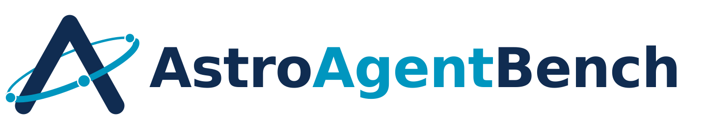
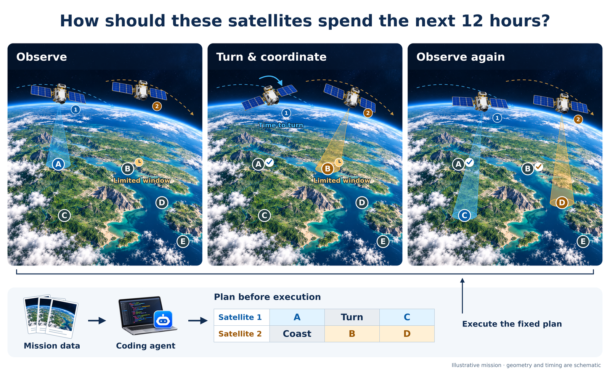
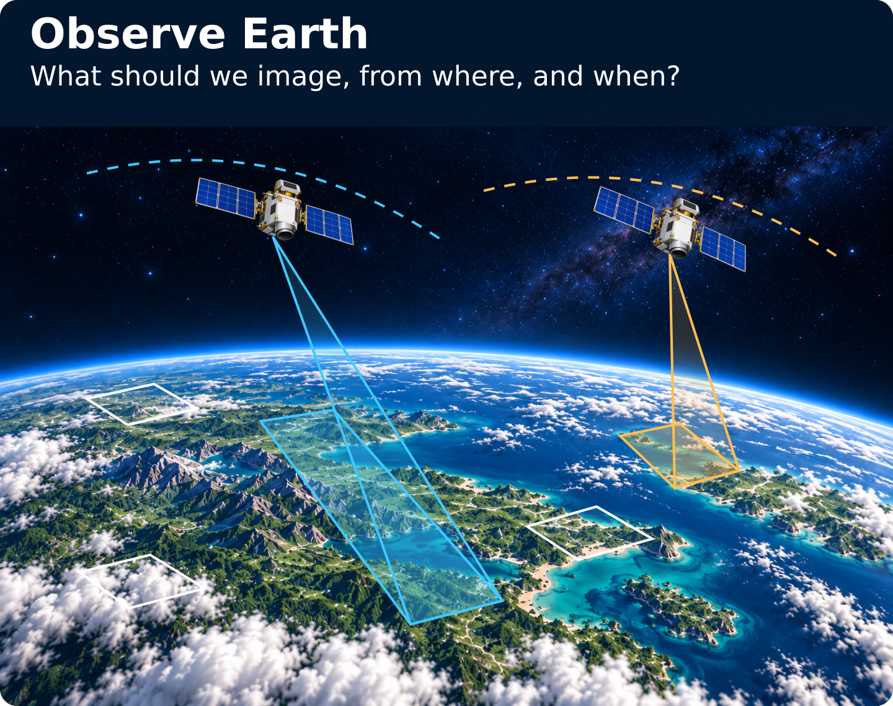
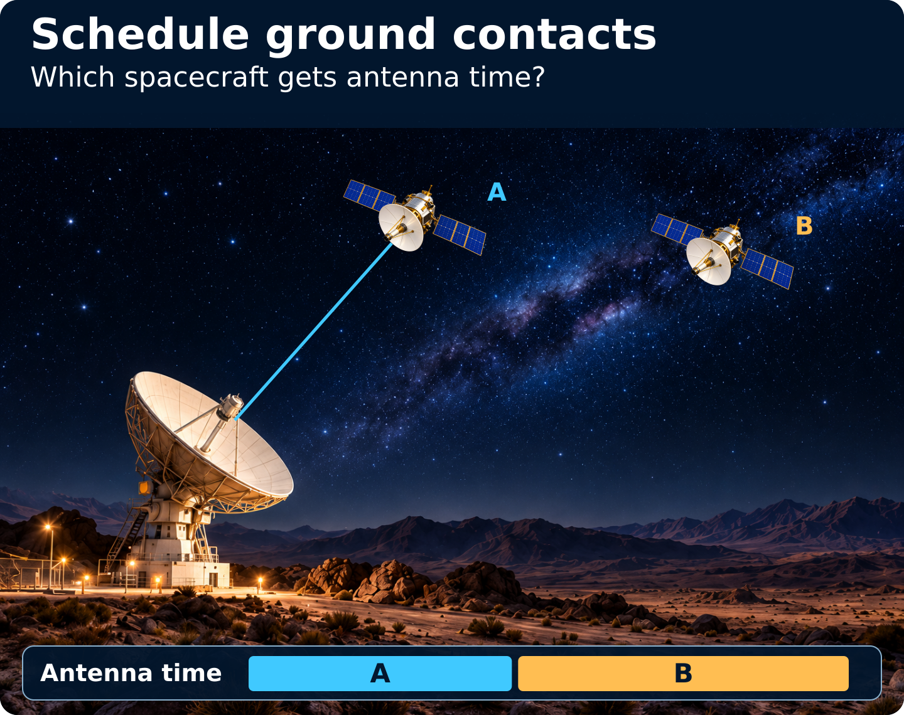
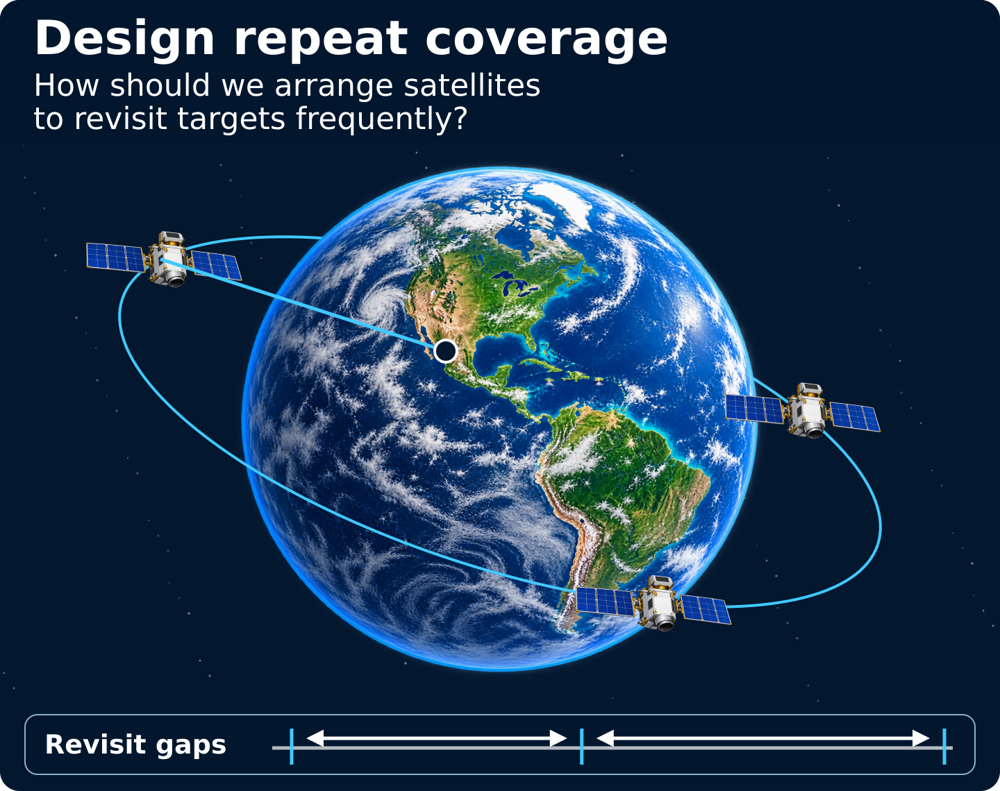
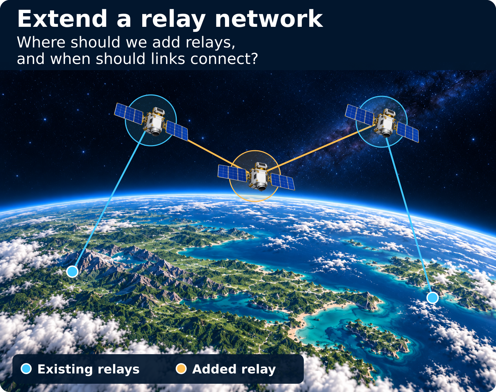
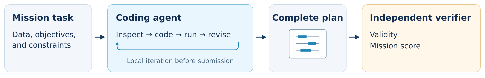
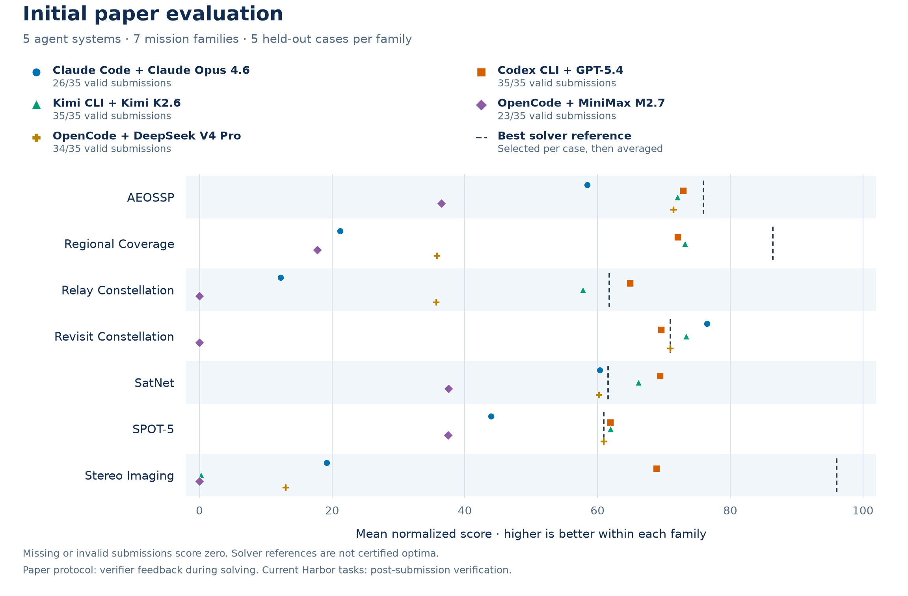

[English](../../../README.md) | 中文

<h1 align="center">
<picture>
<source media="(prefers-color-scheme: dark)" srcset="../../../docs/assets/identity/logo-dark.svg">

</picture>
</h1>
<!-- i18n-source-sha256: 2d926804a45cae272f288bf63a7ec04687ecf4ced0d200daac10552f5a51088b -->

**AstroAgentBench 是一套开放的空间任务规划 benchmark，供 coding agent 与传统求解器处理具体的规划问题。** 它提供任务测试实例、独立验证器、参考求解器和评估工具。

[](https://arxiv.org/abs/2601.11354)
[](https://huggingface.co/datasets/kaupane/AstroAgentBench)
[](https://doi.org/10.5281/zenodo.23084447)
[](../../../LICENSE)



*地球观测任务示意：coding agent 先计算完整计划，星座随后执行。几何关系与时序仅作示意。*

[阅读论文](https://arxiv.org/abs/2601.11354) · [获取任务集](https://huggingface.co/datasets/kaupane/AstroAgentBench) · [浏览 agent 轨迹](https://huggingface.co/datasets/kaupane/AstroAgentBench-Traces) · [完整运行归档](https://doi.org/10.5281/zenodo.23084447) · [引用](#引用)

## 探索空间任务

七个 benchmark 家族涵盖四类规划决策，每个家族都提供独立的测试实例文件与验证器。

<table>
<tr>
<td width="50%"><br><a href="benchmarks/aeossp_standard/README.md">AEOSSP</a> · <a href="benchmarks/spot5/README.md">SPOT-5</a> · <a href="benchmarks/regional_coverage/README.md">区域覆盖</a> · <a href="benchmarks/stereo_imaging/README.md">立体成像</a></td>
<td width="50%"><br><a href="benchmarks/satnet/README.md">SatNet</a></td>
</tr>
<tr>
<td width="50%"><br><a href="benchmarks/revisit_constellation/README.md">重访星座</a></td>
<td width="50%"><br><a href="benchmarks/relay_constellation/README.md">中继星座</a></td>
</tr>
</table>

*任务示意：几何关系、航天器大小与时序均不按实际比例绘制。*

## Coding agent 如何参与



任务以 [Harbor 任务包](https://huggingface.co/datasets/kaupane/AstroAgentBench)提供：coding agent 根据任务数据与约束，通过编写代码求解，并提交完整计划接受[独立验证](../../../experiments/evaluate/README.md)。验证器检查可行性并衡量任务价值，所得结果可用于评估，也可为强化学习提供反馈。

## 目前的发现

Coding agent 已能构造可行的空间任务计划，但可行性只是起点。初步评估发现，不同系统与任务之间的任务价值差异显著：一些结果接近或超过专用求解器参考值，另一些仍有较大提升空间。



每个点表示五个留出测试实例的平均归一化得分，缺失或非法提交按零分计入。请在同一任务家族内比较系统。[论文](https://arxiv.org/html/2601.11354v3#S4)提供原生指标、置信区间和分析。

> **评估协议不同：**这些结果来自初步论文评估，当时 agent 可在求解过程中获得验证器反馈。当前 Harbor 任务将验证器与求解环境隔离，在提交后独立验证。复现论文请使用[冻结快照](https://github.com/Mtrya/AstroAgentBench/tree/aacl-ijcnlp-2026)及其记录的配置。

- **合法的计划仍可能完成很少的任务。**两套系统在全部 35 个测试实例上提交了合法计划，但它们在不同家族上的任务得分差异显著。
- **与求解器的差距取决于任务。**部分 agent 的平均得分超过参考值，而 Regional Coverage 和 Stereo Imaging 仍有较大差距。部分 Stereo 运行还受到文档中横向符号约定歧义的影响，不能将这些结果完全归因于规划能力。

**[查看评估结果](https://arxiv.org/html/2601.11354v3#S4) · [浏览 agent 轨迹](https://huggingface.co/datasets/kaupane/AstroAgentBench-Traces) · [运行自己的 agent](../../../experiments/evaluate/README.md#agent-systems)**

轨迹数据集提供可浏览的 Claude Code 与 Codex 会话；其他系统及完整运行产物见 [Zenodo 归档](https://doi.org/10.5281/zenodo.23084447)。

<details>
<summary>完整数值与评估设置</summary>

论文在 **35 个留出的测试实例（每个家族五个）**上评估每套系统。每次运行使用 8 个 AMD Ryzen 7 9700X 核心、32 GB 内存，时限为两小时。下表每项得分是该家族五个测试实例的平均归一化得分，越高越好；缺失或非法提交按零分计入。“合法提交数”表示通过验证器检查的提交数量。

| Agent 系统 / 参考 | 合法提交数 | AEOSSP | Regional | Relay | Revisit | SatNet | SPOT-5 | Stereo |
|---|---:|---:|---:|---:|---:|---:|---:|---:|
| Claude Code + Claude Opus 4.6 | 26/35 | 58.45 | 21.22 | 12.25 | 76.50 | 60.36 | 43.96 | 19.16 |
| Codex CLI + GPT-5.4 | 35/35 | 72.91 | 72.08 | 64.91 | 69.58 | 69.45 | 61.92 | 68.91 |
| Kimi CLI + Kimi K2.6 | 35/35 | 72.03 | 73.15 | 57.77 | 73.36 | 66.14 | 61.92 | 0.25 |
| OpenCode + MiniMax M2.7 | 23/35 | 36.44 | 17.73 | 0.00 | 0.00 | 37.54 | 37.47 | 0.00 |
| OpenCode + DeepSeek V4 Pro | 34/35 | 71.44 | 35.79 | 35.67 | 70.95 | 60.23 | 60.91 | 13.00 |
| 最优求解器参考 | — | 75.95 | 86.44 | 61.79 | 70.98 | 61.59 | 60.92 | 96.05 |
| 次优求解器参考 | — | 71.65 | 76.26 | 58.20 | 63.33 | 55.95 | — | 92.00 |

求解器参考值先在每个测试实例上分别选取，再在家族内取平均；这些值用来衡量相对质量，并非经过证明的最优解。SPOT-5 只有一组参考值。各家族采用自己的评分规则，应在同一列内比较得分。数据来自论文表 3，也提供[机器可读数值](../../../docs/assets/initial-results/data.json)。

</details>

## 动态

- **2026 年 10 月：**[可运行的 Harbor 任务集与可浏览的原生 agent 轨迹](https://github.com/Mtrya/AstroAgentBench/releases/tag/v2.0.0)已在 Hugging Face 发布。
- **2026 年 10 月：**[AACL-IJCNLP 2026 论文](https://arxiv.org/abs/2601.11354v3)已公开，包含五套系统的评估结果，并提供 [Zenodo 运行归档](https://doi.org/10.5281/zenodo.23084447)。

## 资源

| 我想要…… | 从这里开始 |
|---|---|
| 了解 benchmark 与研究发现 | [论文](https://arxiv.org/abs/2601.11354) |
| 运行已发布的任务 | [Hugging Face 任务集](https://huggingface.co/datasets/kaupane/AstroAgentBench)与[评估说明](../../../experiments/evaluate/README.md) |
| 查看 agent 如何求解任务 | [可浏览的 Claude Code 与 Codex 会话](https://huggingface.co/datasets/kaupane/AstroAgentBench-Traces) |
| 检查完整运行记录 | [Zenodo v1 归档](https://doi.org/10.5281/zenodo.23084447)，包含其他系统及运行产物 |
| 复现论文 | [论文快照与说明](https://github.com/Mtrya/AstroAgentBench/tree/aacl-ijcnlp-2026) |

## 引用

如果你使用 AstroAgentBench，请引用我们的 AACL-IJCNLP 2026 论文：

```bibtex
@inproceedings{wang2026astroagentbench,
  title = {{AstroAgentBench}: Evaluating Agentic Planning on Space Mission Planning Tasks},
  author = {Wang, Weiyi and Chen, Xinchi and Gong, Jingjing and Huang, Xuanjing and Qiu, Xipeng},
  booktitle = {Proceedings of AACL-IJCNLP 2026},
  year = {2026},
  eprint = {2601.11354},
  archivePrefix = {arXiv},
  url = {https://arxiv.org/abs/2601.11354}
}
```

## 快速开始

安装 [uv](https://docs.astral.sh/uv/) 以及带 Docker Compose 的 Docker。以下命令均在仓库根目录执行。Python 3.13.11 及 Python 依赖均已锁定版本。

```bash
uv sync --locked --extra evaluation
docker build -t astroagentbench-python:latest runtimes/python
export HARBOR_TELEMETRY=0
```

借助现成的 SPOT5 参考解做一次开销很低的检查，全程不调用模型：

```bash
uv run --locked --extra evaluation python -m experiments.evaluate.prepare spot5 test 8 --output .runtime/tasks/spot5-check --reference-solution benchmarks/spot5/dataset/example_solution.json
uv run --locked --extra evaluation harbor run -p .runtime/tasks/spot5-check -a oracle -n 1 --jobs-dir results --job-name spot5-check
uv run --locked --extra evaluation python -m experiments.evaluate.aggregate results/spot5-check --output results/spot5-check.jsonl
```

`results/spot5-check.jsonl` 中的汇总结果应包含 `"status": "valid"` 和 `"valid": true`。

准备阶段拒绝覆盖已有的任务目录。换一次运行就要换新的输出目录名和作业名。这项检查覆盖安装、产物传递和评分三个环节，它不是 agent 评估，也不是论文复现。

## 评估系统或求解器

不带 `--reference-solution` 准备任务，然后选择 Harbor 已安装的 agent 适配器，或自行实现 `BaseAgent`。系统写出 `/workspace/solution/solution.json`；Harbor 收集该目录，并在独立容器中完成评估。无需任何仓库专用的模型路由或推理协议。

[评估说明](../../../experiments/evaluate/README.md) 涵盖系统适配器、交互式测试实例查看、一个有真实计算上限的 CELF 求解器示例、配置、结果与局限。传统求解器在 [solvers/](../../../solvers/finished_solvers.json) 下保留各自独立的 `setup.sh` / `solve.sh` 接口，每个求解器的 README 都会说明其方法和计算需求。

## 版本与贡献

`main` 分支随项目持续演进。[`aacl-ijcnlp-2026`](https://github.com/Mtrya/AstroAgentBench/tree/aacl-ijcnlp-2026) 保留了 AACL-IJCNLP 论文所用的五月投稿版本实现。一月份的 AstroReason-Bench 快照保存在 [`acl-submission-2026`](https://github.com/Mtrya/AstroAgentBench/tree/acl-submission-2026) 中。历史研究流程属于各自的快照与历史记录。

贡献可以新增 benchmark，改进验证器或工具，扩展求解器基线，或者评估一套新颖的 agent 系统。请从 [CONTRIBUTING.md](../../../CONTRIBUTING.md) 开始。benchmark 发布件同样会为 Hugging Face 做准备，并附带 Git 提交与校验和作为来源说明，参见[发布暂存](docs/releases.md)。

仓库将 [benchmarks](docs/benchmark_contract.md)、[evaluation](docs/experiment_contract.md)、[solvers](docs/solver_contract.md) 和 [runtimes](docs/runtime_contract.md) 彼此分离。benchmark 验证器定义合法性与原生得分。请在声明的配置下比较系统，不要把互不相干的指标揉进同一个分数里。
